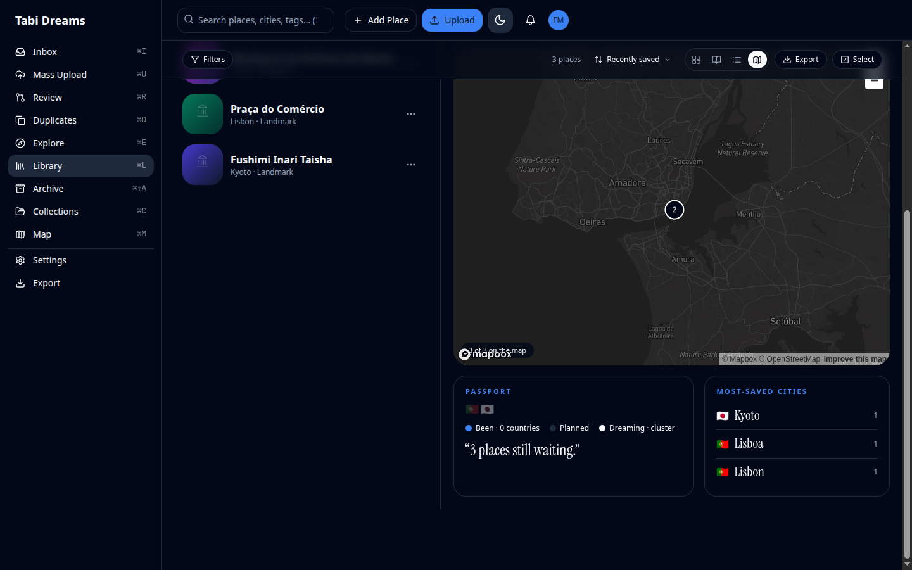
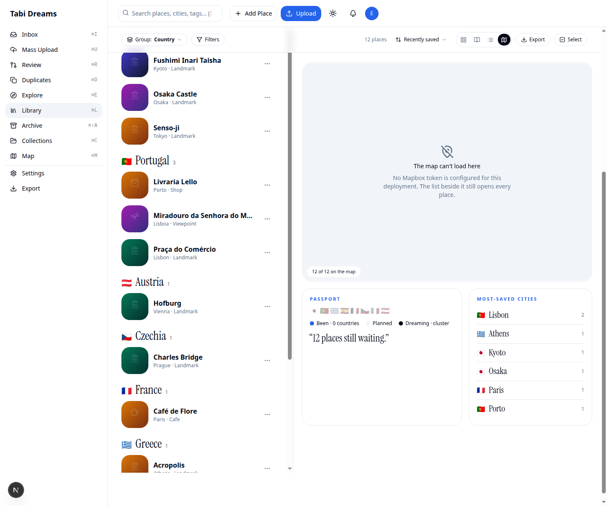
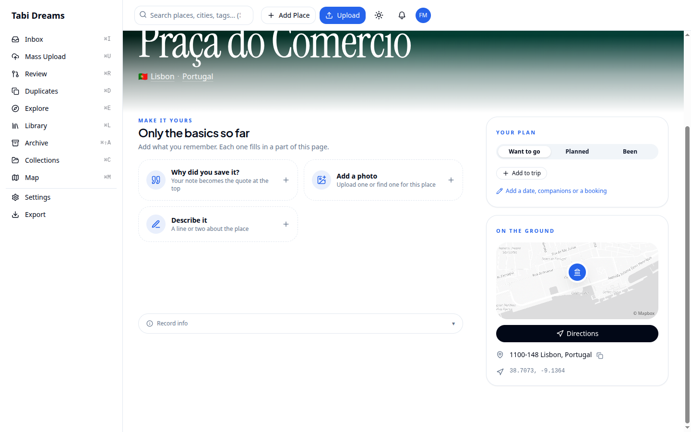
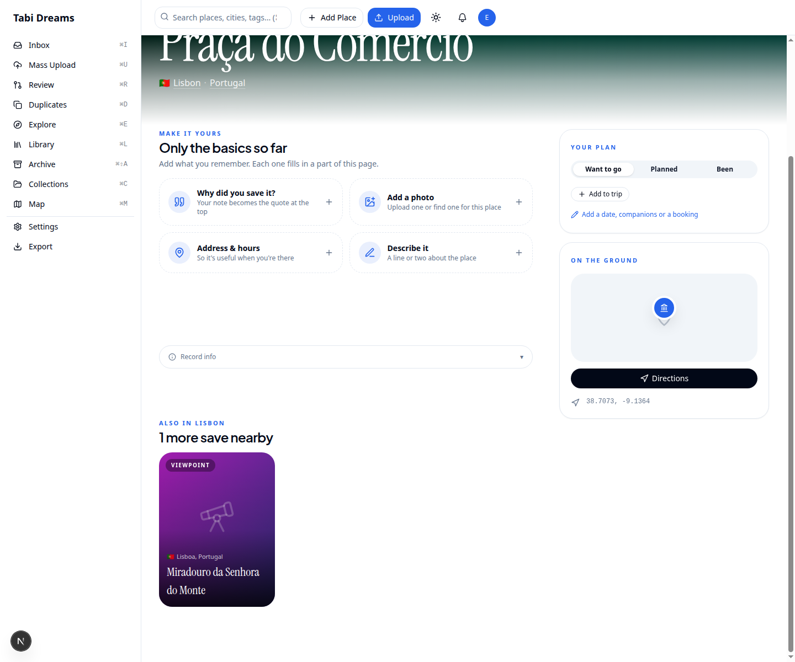

# City names — English saves, folded matching

Before shots are the live check of tabidreams.com (Praça stored as Lisbon, Miradouro stored as Lisboa): the place page had no “Also in Lisbon” rail, and Most-saved cities listed Lisboa and Lisbon as two rows.

After shots are this branch against a throwaway SQLite file built from the repo migrations (`file:` only). The same two spellings stay in the `city` column. Matching folds case and diacritics and applies a small exonym map, so they count as one city. New Google Places autocomplete and details calls ask for `language=en`.

| Before | After | What it shows |
|---|---|---|
|  |  | **Most-saved cities.** Before: Lisboa 1 and Lisbon 1. After: one Lisbon row with count 2. The place rows still show the stored spellings (Lisboa and Lisbon). |
|  |  | **Also in {city}.** Before: Praça’s page had no rail. After: “Also in Lisbon” includes Miradouro, whose stored city is still Lisboa. |

Also checked live, not in the table: grouping the library by city makes one Lisbon chapter (index “11 cities”, “Lisbon 2”) containing both places (`after-library-city-group.png`); `?city=Lisboa` returns both and leaves Porto out; `/explore/atlas/portugal/lisbon` lists both saves.
