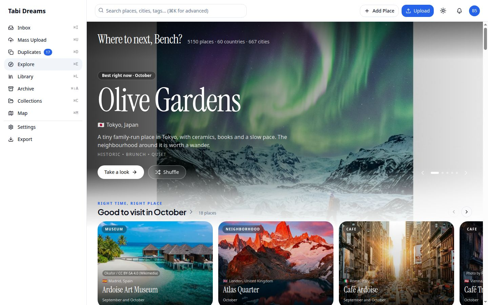
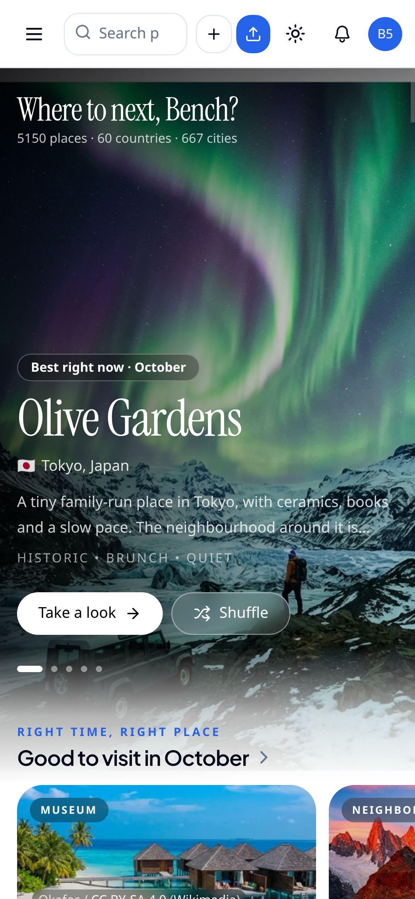
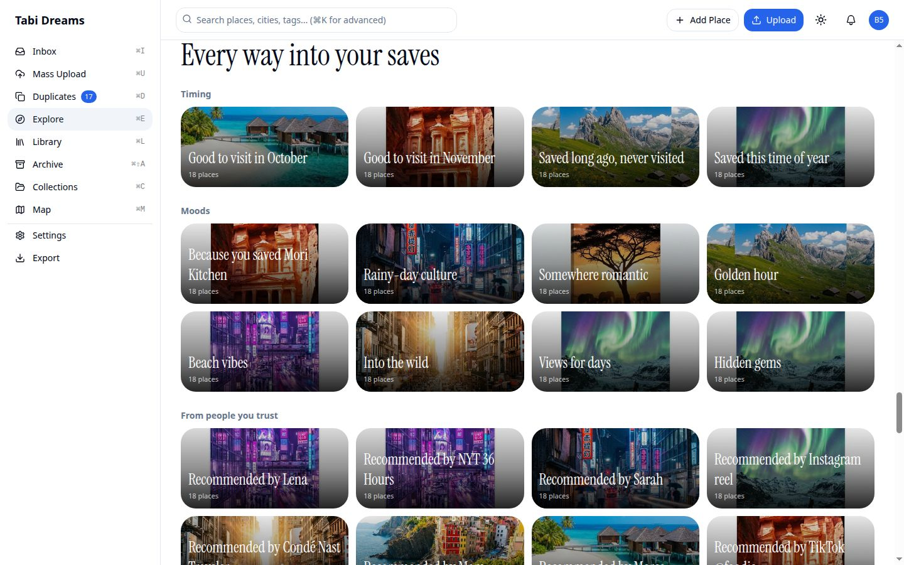
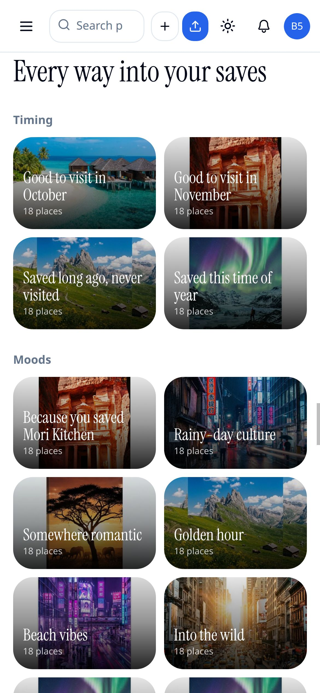
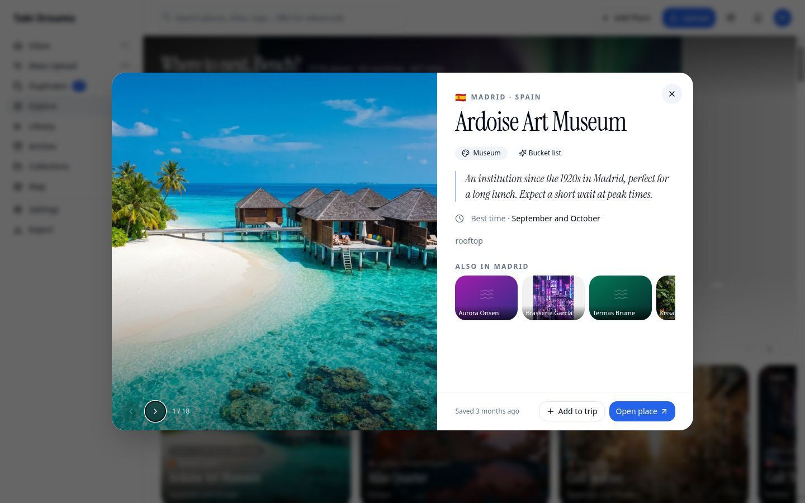
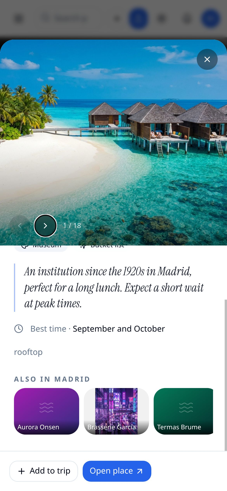

# Explore scoped payloads — evidence

Before/after captures for the change that stops Explore from serializing the whole library
into every Explore route (and into every link prefetch of one). Each page wraps itself in
`ExploreScope` with only the places it renders; Browse-all covers are chosen on the server;
quick look's "Also in this city" loads from `GET /api/explore/same-city/[placeId]` when the
sheet opens. Existing features stay.

Desktop is 1440×900; phone is 1170×2532. Each `*-baseline.jpg` / `*-after.jpg` pair is
**byte-identical** — visual parity for a payload-only change.

| Baseline | After | Surface |
|---|---|---|
|  |  | Explore home, desktop |
|  |  | Explore home, phone |
|  |  | Browse all shelf, desktop |
|  |  | Browse all shelf, phone |
|  |  | Quick look sheet, desktop |
|  |  | Quick look sheet, phone |

**Covered by tests, not screenshotted:** `ExploreScope` / layout no longer ship the full
library (`explore-scope`, `explore-layout`); server-side Browse-all covers (`browse-rails`);
quick look's same-city fetch (`place-sheet`); and tenant isolation of
`GET /api/explore/same-city/[placeId]` (`same-city-route`, `cross-tenant-sweep`).
