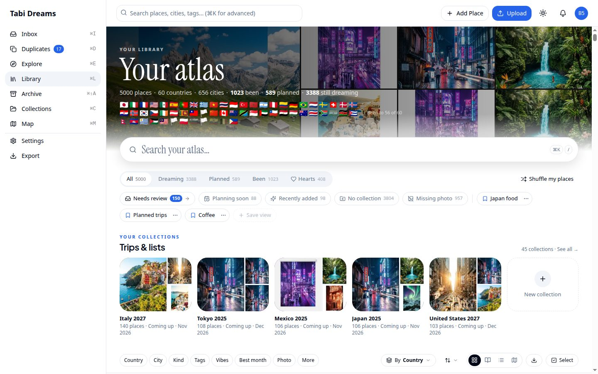
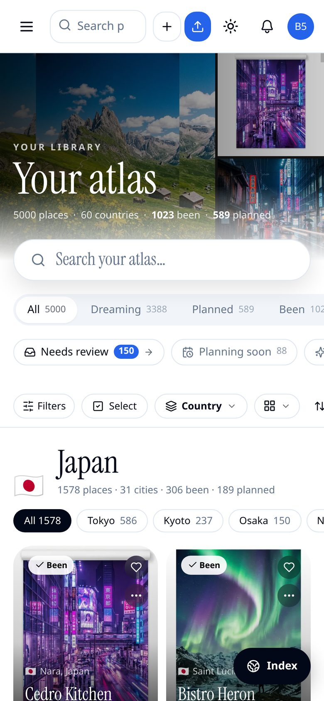
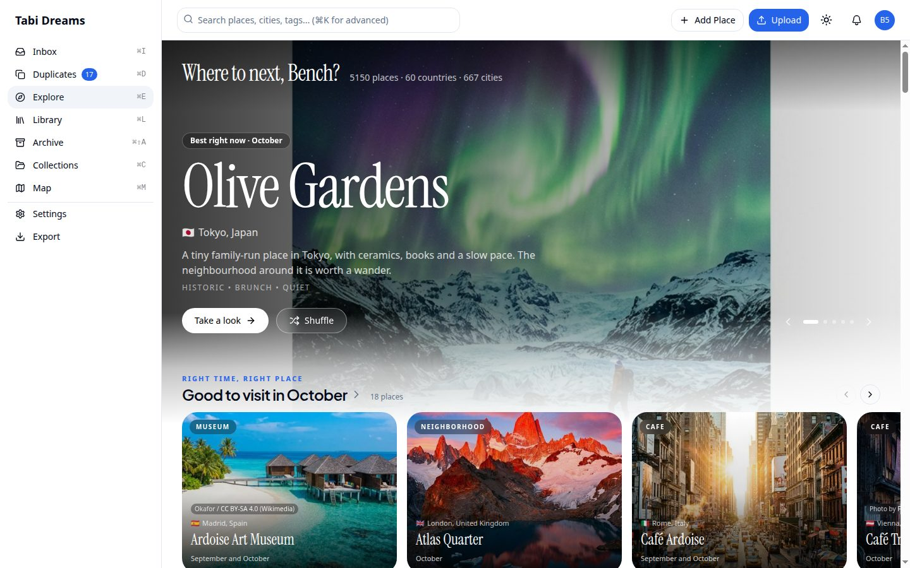
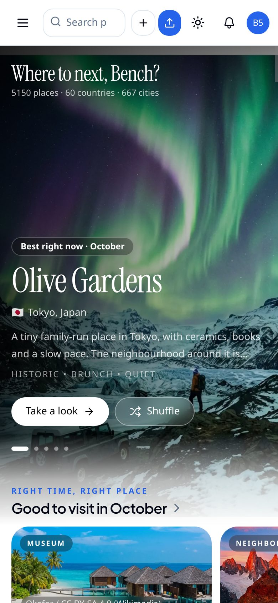
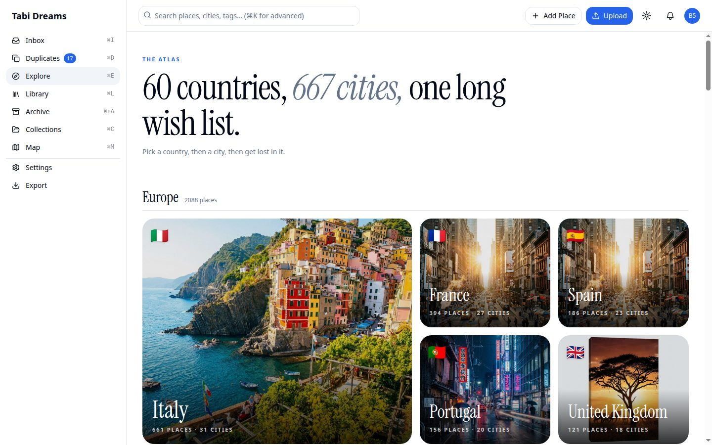
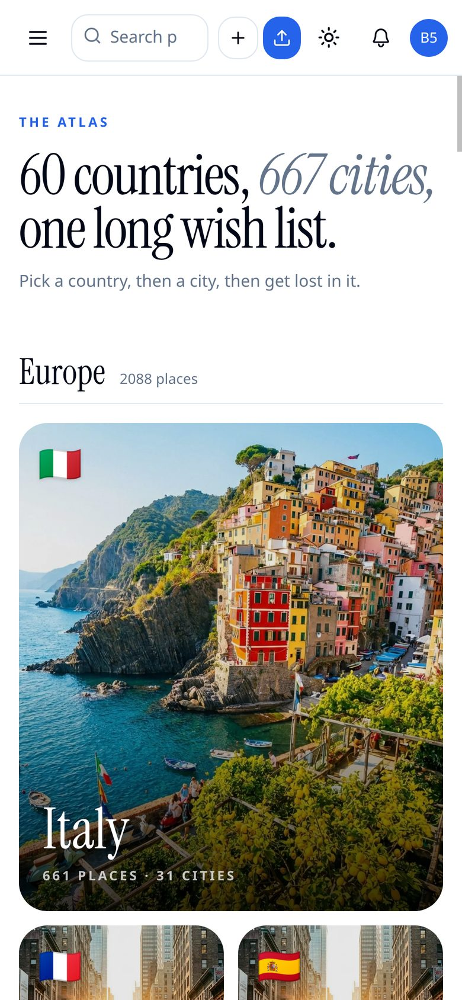

# Right-sized Library and Explore photos — evidence

Before/after captures for the change that routes every Library and Explore photo
through `Photo` (`src/components/photo.tsx`): Blob, Pexels and Wikimedia go through
the Next image optimizer with real `sizes`; Google resolver URLs are sized with
`?w=` and never enter the optimizer. Existing features stay; this is a download-
sizing change, not a layout redesign.

Desktop is 1440×900; phone is 780×1688. Each `before-*` / `after-*` pair is the
same surface after the swap — layout and copy match; photo sharpness at tile and
cover sizes is the intended difference.

| Before | After | Surface |
|---|---|---|
|  |  | Library home, desktop |
|  |  | Library home, phone |
|  |  | Explore home, desktop |
|  |  | Explore home, phone |
|  |  | Explore atlas, desktop |
|  |  | Explore atlas, phone |

**Covered by tests, not screenshotted:** `Photo` routing and `?w=` / `/_next/image`
sizing (`photo`, `photo-url`); Library and Explore call sites emit right-sized
markup (`library-explore-sizing`); Shuffle warms the same sized URL the card will
request (`shuffle-deck`); `images.remotePatterns` stays aligned with
`photo-url` hosts (`photo-url`).
