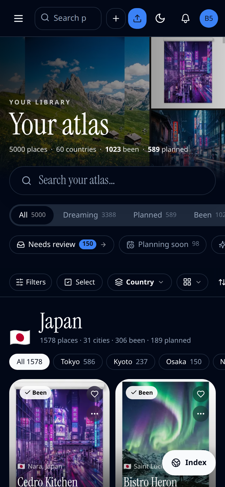

# Library local-first index, stage 1 (delivery) — evidence

The Library no longer carries the library inside its page. `/library` now sends
the first screen (cover, shelf counts, the first chapters' tiles, built on the
server from the same pure functions the client runs) and the version of the
index that holds the rest. The browser fetches that index once per version from
`/api/library/index?v=<version>` (`Cache-Control: private, max-age=31536000,
immutable`), keeps it, and the full page takes over when it lands. Libraries of
150 places or fewer still ride in the page whole.

Desktop is 1440×900; phone is 390 wide at 2×. 5,000-place seeded library, local
SQLite database, production build (see the PR body for the harness and numbers).

| Before | After | What it shows |
|---|---|---|
|  |  | Library home once loaded, desktop (visual parity) |
|  |  | Library home once loaded, phone (visual parity) |

The first screen, as painted before the index arrives (the index held back for
the capture; the controls that need the whole library are the empty frames they
fill in as the page takes over):

| First screen, desktop | First screen, phone |
|---|---|
|  |  |

**Covered by tests, not screenshotted:** the wire format round trip
(`wire.test.ts`), the first screen matching the client's chapters
(`first-screen.test.ts`), the store (`index-store.test.tsx`), the first screen
handing over to the full page with quick look kept open
(`library-indexed.test.tsx`), the version moving on every edit the index shows
and holding still for hearts, saved views, the Inbox and other tenants
(`authorization/library-index-route.test.ts`), both new routes in the
cross-tenant sweep, and sign-out clearing the browser cache
(`auth-signout-clears-cache.test.ts`).
