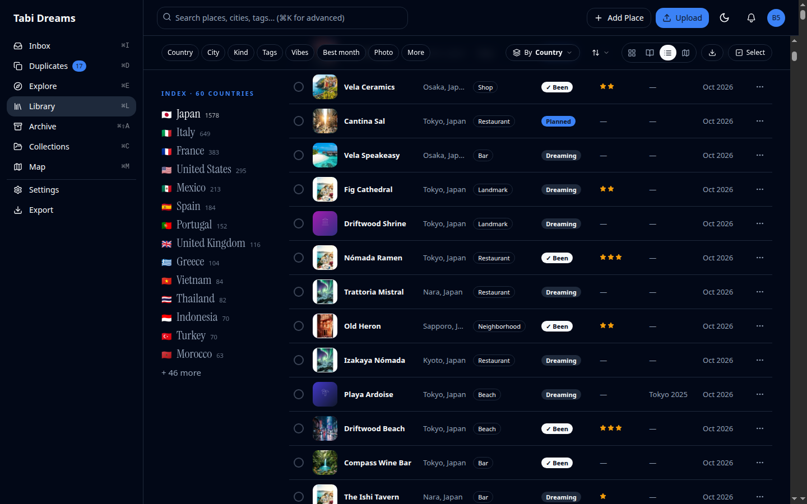
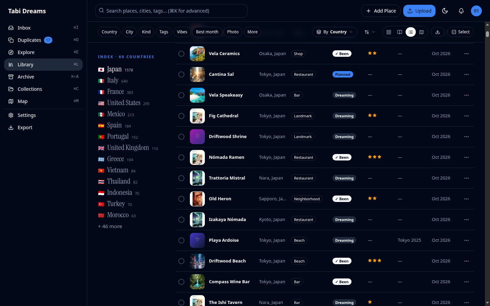
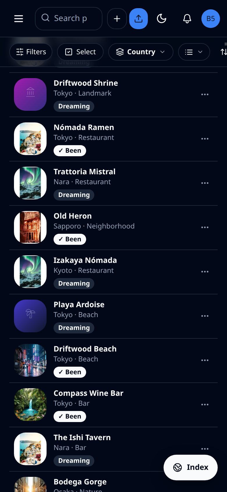
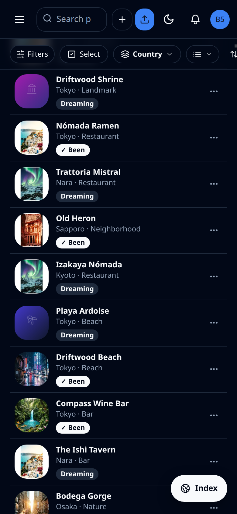
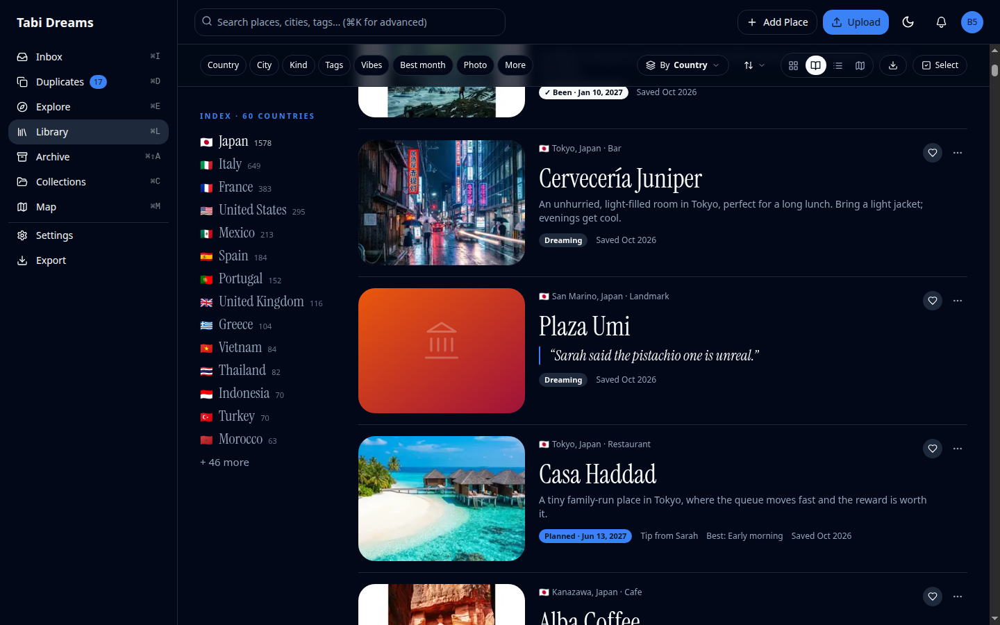
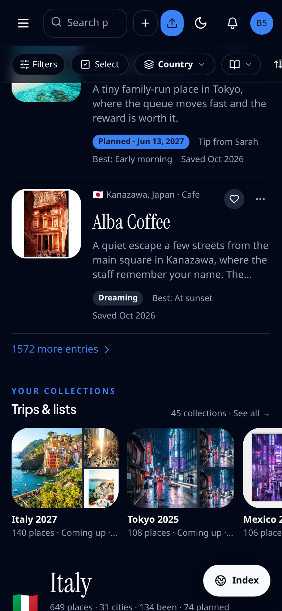
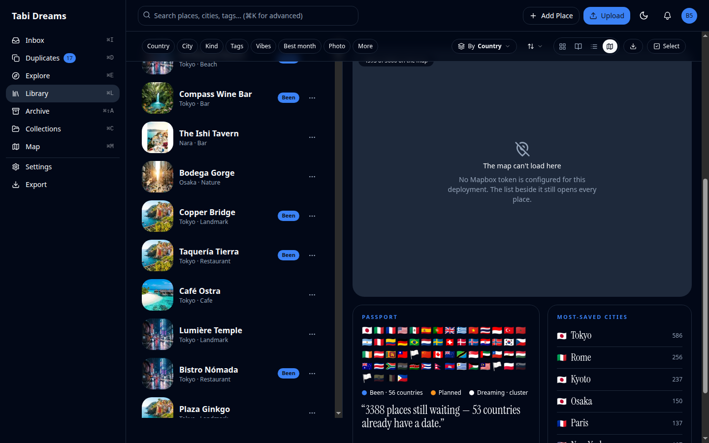
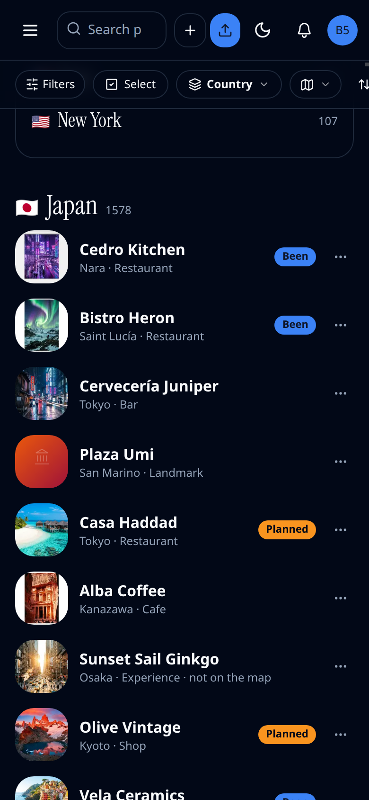

# Library list, journal, and map side-list virtualization — evidence

Before/after captures for the change that virtualizes the Library **compact list**,
**journal**, and **map-view side list** on the same row engine as the gallery
(`VirtualRows`: a flat list of keyed rows, windowed against the real scroll
container). Only rows near the screen are mounted. Per-chapter "Show N more"
buttons stay as they were (UX unchanged; they are no longer a performance
device). Existing features stay.

The compact list and journal window against the (app) shell's `<main>`. The map
side list does the same below `lg`; from `lg` it windows against its own
`[data-side-list]` scroller (with scroll padding for sticky tools skipped on
that box). Scroll position is restored on Back from a place page for all three
views (`src/lib/library/scroll-memory.ts`).

Gallery-only evidence stays in
[`docs/evidence/td-library-perf-build/`](../td-library-perf-build/).

Desktop is 1440×900; phone is 780×1688. Pairs are visual parity on a large
library.

| Before | After | What it shows |
|---|---|---|
|  |  | Compact list, desktop |
|  |  | Compact list, phone |
|  |  | Journal, desktop |
|  |  | Journal, phone |
|  |  | Map side list, desktop |
|  |  | Map side list, phone |

**Covered by tests, not screenshotted:** row building and breakpoint-gated
columns / phone interlude (`entry-rows`); "Show N more", a11y
`aria-rowcount` / `aria-rowindex` (list) and `aria-setsize` / `aria-posinset`
(journal and map), Back scroll restore on map at both breakpoints (main vs
side list), j/k against the side-list viewport from `lg`, and the ~3,000-node
DOM gate at 5,000 places (`library-virtual-entries`).
