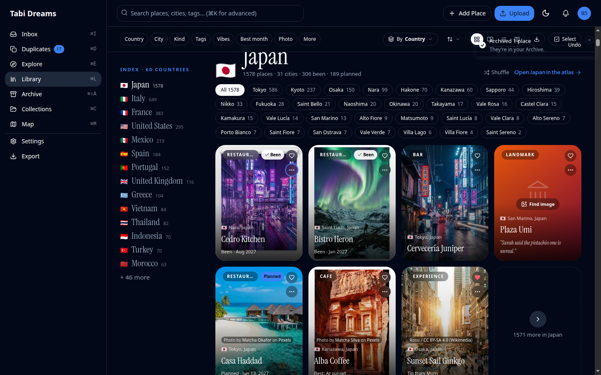
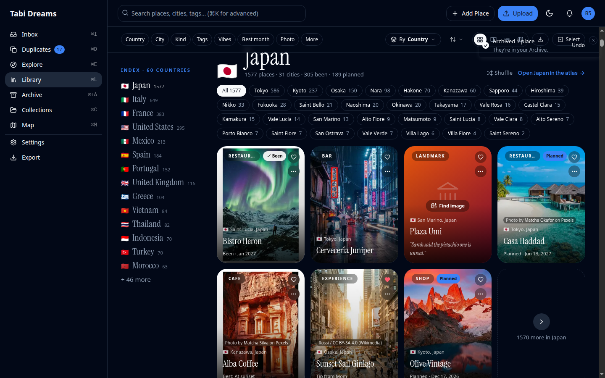

# Library local-first index, stage 2 (mutations) — evidence

An edit made on the Library no longer reloads the page. Archive, restore (Undo),
status changes, delete, add place, find image and add-to-collection patch the
browser's copy of the index at once, tell the server, and then check the library
in the background: `GET /api/library/version`, and `GET /api/library/index?v=<new>`
only if that version is not the one already held. A refused edit comes off the
screen again with its error. A library of 150 places or fewer still rides in the
page and re-renders from the server as before.

Desktop is 1440×900; phone is 390 wide at 2×. 5,000-place seeded library, local
SQLite database, production build (`next build` + `next start`), headless Chrome
driven with chrome-devtools-axi, one fresh browser profile per run.

## What the screenshots show

Each photograph is taken 1.5 s after pressing **Archive** on the first place of
the first chapter, with the Library index held back (a slow connection). A page
that waits for the library to come back still shows the place and the old counts;
the patched page has already dropped it and counted one fewer.

| Before (main) | After |
|---|---|
|  |  |
|  |  |

## Gate numbers

Archive one place from its ⋯ menu; time from the key press to the frame that
shows the new count (median of 3, 5 for the 5k baseline; the first baseline run
after a server start is dropped as a cold start).

| | 2,000 before | 2,000 after | 5,000 before | 5,000 after |
|---|---:|---:|---:|---:|
| Archive → new count on screen (ms) | 376 | **40** | 724 | **73** |
| Page (RSC) reload after the edit | 10.7 kB | **none** | 11.7 kB | **none** |
| Version check (kB) | — | 0.3 | — | 0.3 |
| Library index fetched in the background (kB, brotli) | 184 | 184 | 450 | 450 |
| Interaction → next paint (INP, ms) | 16 | 48 | 16 | 80 |
| Blocking time in the update (ms) | 0 | 0 | 29 | 19 |

Before, the count changed only when the reloaded page's index had come back
(about 700 ms at 5k); the 16 ms INP is the click itself, with nothing on screen
changing until later. After, the page repaints inside the click, so the update
is counted in the interaction. The index that follows is the new version, fetched
once, and finds what the page already shows: nothing re-renders.

## Covered by tests

- `index-patch.test.ts` — every patch kind, and that applying one twice is
  applying it once; reusing unchanged places when a fetch confirms the screen.
- `index-store-mutations.test.tsx` — shown at once; rolled back; the part of a
  bulk edit that landed is kept; version check then fetch only when it moved;
  an edit that did not move the version is dropped for the server's word; edits
  still in flight or committed after a fetch began stay on top of it; one
  revalidation at a time; a failed check leaves the screen alone.
- `library-indexed-mutations.test.tsx` — archive, Undo, status, delete, find
  image and a place added from outside the page, on the real Library page, none
  of them calling `router.refresh()`, each with its failure path.
- `add-place-library-sync.test.tsx` — the Add Place dialog patches a Library on
  screen and falls back to a page refresh anywhere else.
- `authorization/library-index-route.test.ts` — the version moves for each write
  the bulk actions make, and the new route answers the caller's own version,
  uncached; `cross-tenant-sweep.test.ts` has its entry.
