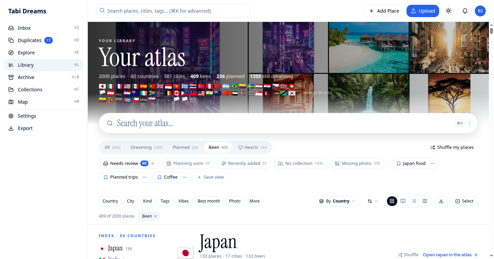
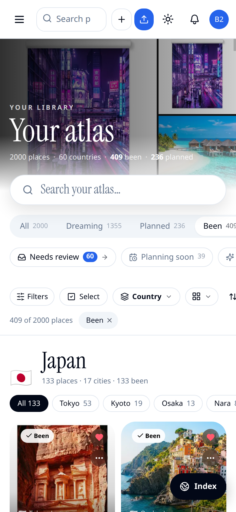

# Library per-tile state and discrete transitions — evidence

Before/after captures for the change that keeps Library interactions fast at
large libraries: hearts and selection are read per place through
`useSyncExternalStore` behind stable action functions
(`LibraryActionsProvider` in `src/components/library/library-actions.tsx`), so
one heart or selection re-renders that place instead of every mounted tile.
Discrete filter, shelf, group, sort and view changes run in `startTransition`
(typing stays urgent). Hearts only enter the filter pipeline on the Hearts
shelf. Existing features stay.

Gallery and list virtualization evidence stays in
[`docs/evidence/td-library-perf-build/`](../td-library-perf-build/) and
[`docs/evidence/td-libperf-lists/`](../td-libperf-lists/).

Desktop is 1440×757; phone is 780×1688. Each `before-*` / `after-*` pair is
visual parity for a state-wiring change (phone pairs are byte-identical).

| Before | After | What it shows |
|---|---|---|
|  |  | Library home, desktop |
|  |  | Library home, phone |

**Covered by tests, not screenshotted:** stable actions and per-id heart /
selection subscriptions (`library-actions`, `library-tile-state`); hearts set
identity when the writer republishes an equal set (`use-library-hearts`);
`startTransition` shelf/filter history vs urgent search, functional Set/smart
updates, and popstate winning over a pending discrete transition
(`library-client-transitions`).
