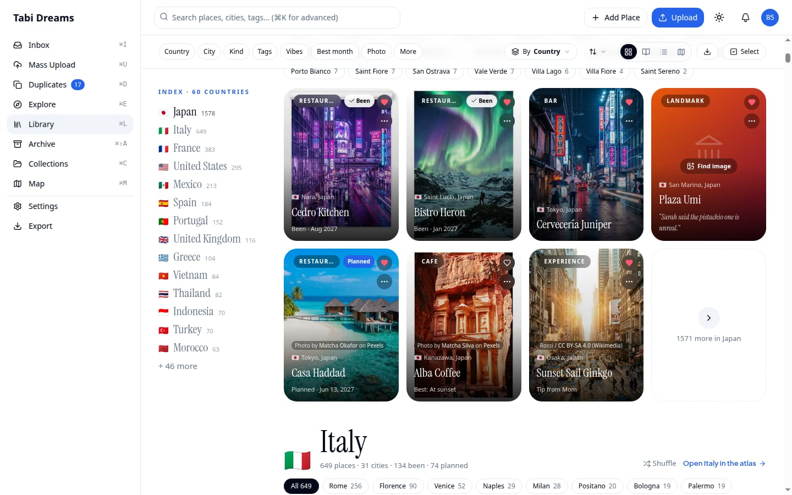
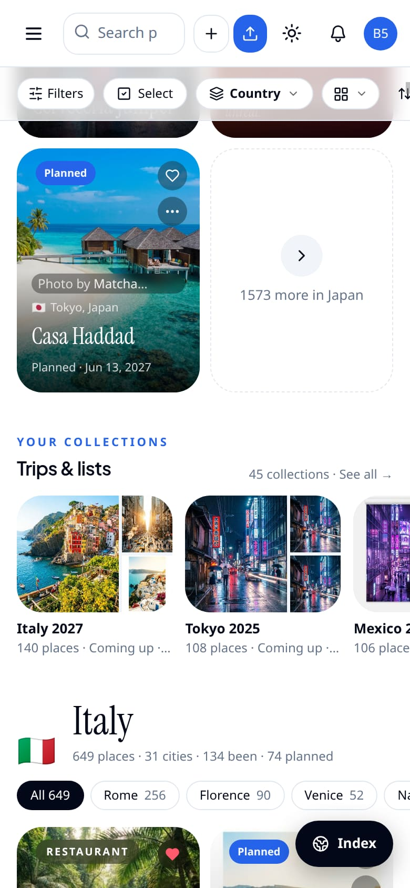
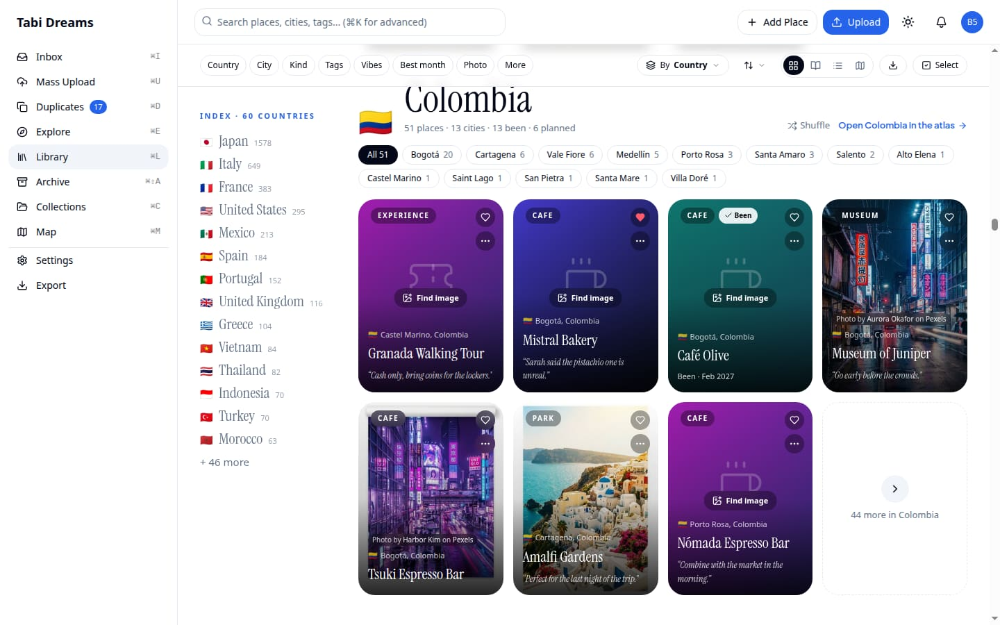
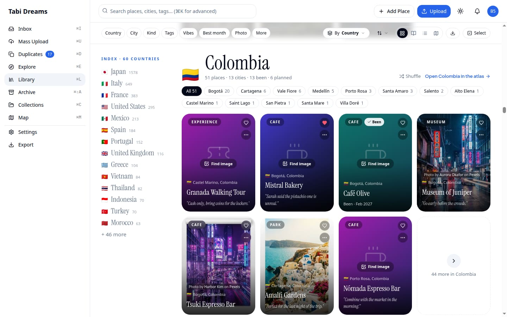
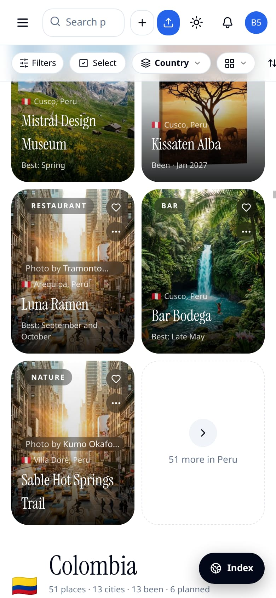
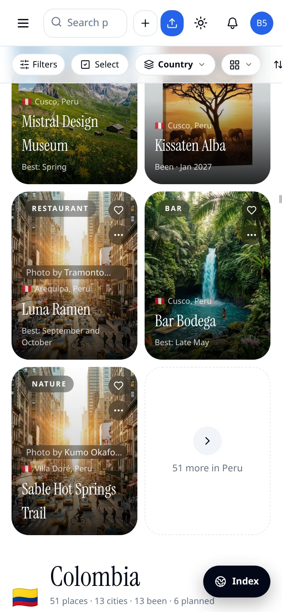
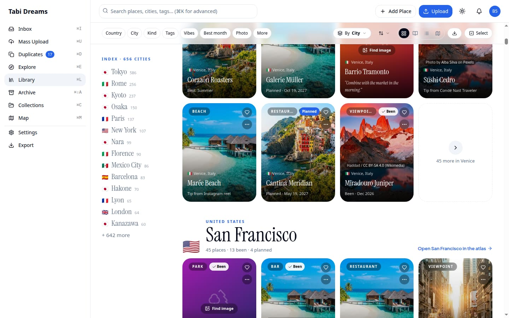
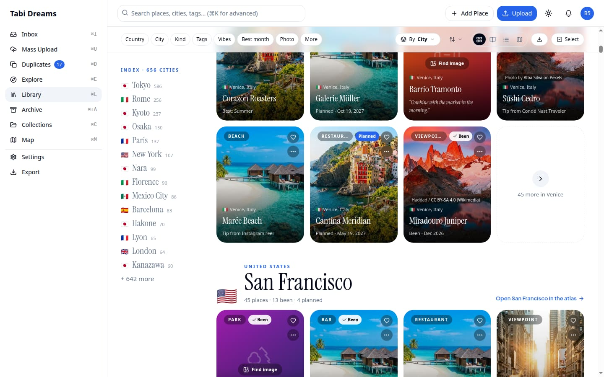
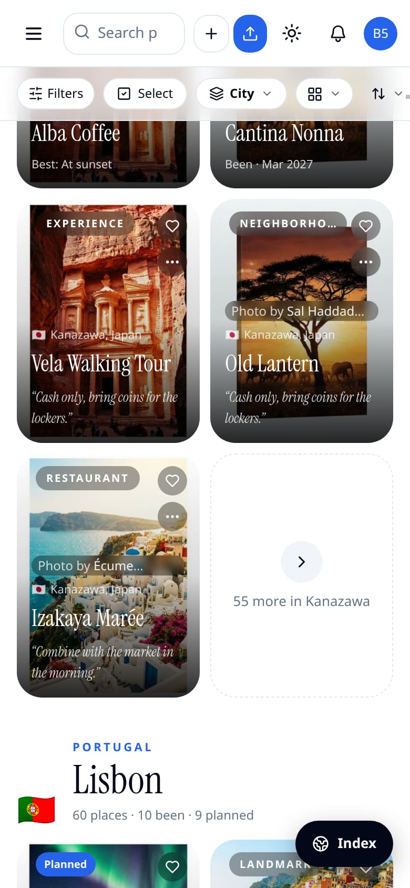
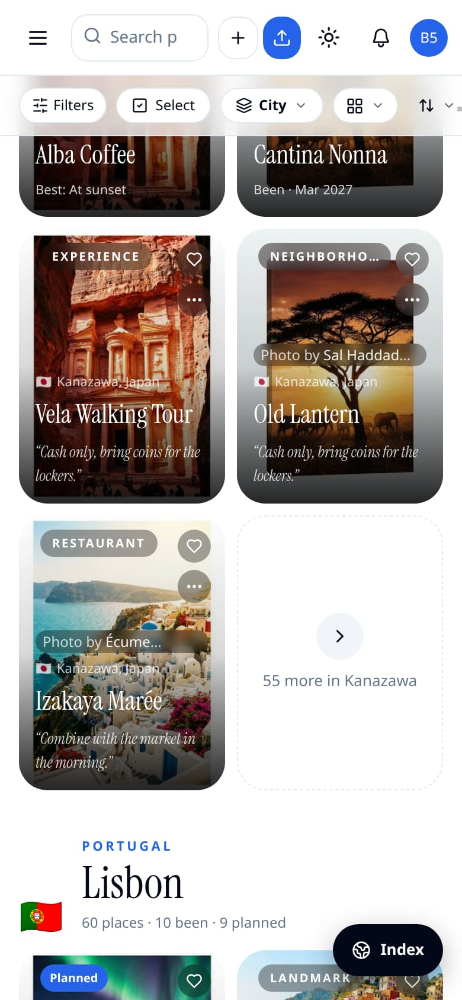

# Library gallery virtualization — evidence

Before/after captures for the change that virtualizes the Library **Group by / No
grouping** grid against the (app) shell's `<main>` (the real scroll container) with
`@tanstack/react-virtual`. The gallery is one flat list of rows (chapter header, a
row of tiles, the phone interlude); only rows near the screen are mounted. Peeks,
"N more", city chips, index jump / scroll-spy, and every grouping stay. This
folder is gallery-only; list, journal, and map side-list virtualization:
[`docs/evidence/td-libperf-lists/`](../td-libperf-lists/).

An earlier attempt virtualized the **window** and was reverted (wrong
`scrollMargin` for the nested layout); this build measures against `<main>` with
`getBoundingClientRect` / `measureElement`. Scroll position is restored on Back
from a place page (`src/lib/library/scroll-memory.ts`). The list follows
`useDeferredValue(filters)` so a keystroke does not re-chapter inside the urgent
update.

Pairs are visual parity on a large library (~60 countries / hundreds of cities).
Desktop is 1440×900; phone is 390×844 at 2×.

| Before | After | What it shows |
|---|---|---|
|  |  | Group by Country, top of the gallery (Japan peek + Italy header), desktop |
|  |  | Same, phone |
|  |  | Group by Country, mid-scroll (Colombia chapter), desktop |
|  |  | Same, phone |
|  |  | Group by City, mid-scroll (Venice → San Francisco), desktop |
|  |  | Same, phone |

**Covered by tests, not screenshotted:** row building per grouping
(`gallery-rows`); jump, scroll-spy, a11y `aria-setsize` / `aria-posinset`, Back
scroll memory (including unmount flush keyed by the Library URL at scroll time)
in `library-virtual-gallery`.
